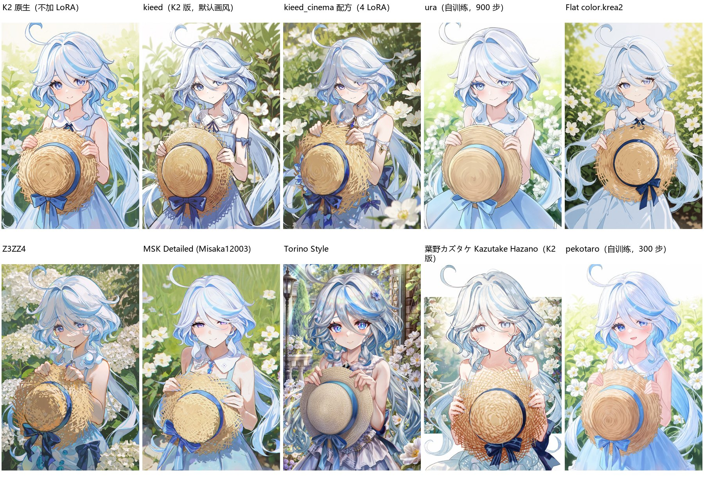

# 本地 LoRA 效果图鉴

自动生成，不要手改：改 `loras.json` 后运行 `python build_gallery.py`。
同一组内的样图用同一段芙宁娜提示词、同一 seed（7301）生成，只换 LoRA 和触发词；K2 为两段采样 832×1248，Anima 为 32 步 + 1.5 倍高清修复。

「可卖图」指 Civitai 页面上作者是否允许出售生成的图片；不确定的一律只自用。

## Krea 2 Turbo（K2）画风 LoRA

| 样图 | 名称 | 文件（强度） | 触发词 | 预设 | 用途 / 效果 | 许可 | 来源 |
|---|---|---|---|---|---|---|---|
| [看图](samples/k00_base.jpg) | K2 原生（不加 LoRA） | — | 无 |  | 对照组：Krea 2 Turbo int8 本身的画法。样图：本身就偏二次元，草帽纹理和花丛细节多，线条偏硬。 |  |  |
| [看图](samples/k01_kieed.jpg) | kieed（K2 版，默认画风） | `kieed_v1_epoch20.safetensors` (1.0) | 无 | `style: kieed` | 清透手绘、细线淡彩，人物精致，项目默认画风。样图：线条更细，水彩手绘感，整体更通透。 | 可卖图 | [链接](https://civitai.com/models/2635815?modelVersionId=3345283) |
| [看图](samples/k03_kieed_cinema.jpg) | kieed_cinema 配方（4 LoRA） | `Krea2_TextFusion_Refusal_Reduction.safetensors` (0.8) `kieed_v1_epoch20.safetensors` (0.65) `z3zz4-k2-4_c1-st5000.safetensors` (0.45) `MSK_detailed_krea.safetensors` (0.4) | `MSK,` | `style: kieed_cinema` | 电影感、细节多的宽幅场景（预设默认 21:9，这里为对比用竖图）。2026-10-24 去掉了 Melancholy，样图需重渲。 | kieed/Z3ZZ4/MSK 可卖图，TextFusion 来源不明 |  |
| [看图](samples/k04_ura900.jpg) | ura（自训练，900 步） | `ura_style_k2_000000900.safetensors` (1.0) | `uraStyle, an anime illustration by uraStyle.` | `style: ura` | 细线、淡阴影、圆脸大眼的清爽粉彩插画。另有 600 步（更淡）和 1200 步（更浓）存档。样图：高调明亮、阴影最少，背景被简化成浅色，脸更圆、眼睛更大。 | 自用 | tools/k2_lora_cloud/README_ura_style.md |
| [看图](samples/k05_flat.jpg) | Flat color.krea2 | `flat1.0_c1-st2000.safetensors` (1.0) | 无 |  | 扁平粉彩、几乎无阴影的白底插画；作者建议强度 0.8–1。样图：在花园背景下扁平效果不明显，白底时更像平涂；配色柔和。 | 不可卖图 | [链接](https://civitai.com/models/2975680?modelVersionId=3372588) |
| [看图](samples/k06_z3zz4.jpg) | Z3ZZ4 | `z3zz4-k2-4_c1-st5000.safetensors` (1.0) | 无 |  | kieed_cinema 配方的组成部分之一。样图：笔触感强，花丛画得像厚涂，人物颜色偏暗。 | 可卖图 | [链接](https://civitai.com/models/2771337?modelVersionId=3120222) |
| [看图](samples/k08_msk.jpg) | MSK Detailed (Misaka12003) | `MSK_detailed_krea.safetensors` (1.0) | `MSK,` |  | 细节和上色增强；kieed_cinema 里用 0.4。样图：明亮清爽、饱和度略高，眼睛偏紫，细节干净。 | 可卖图（作者注明极少数情况会出现签名） | [链接](https://civitai.com/models/2772295?modelVersionId=3121454) |
| [看图](samples/k10_torino.jpg) | Torino Style | `Torino-K2_c1-st6000.safetensors` (1.0) | 无 |  | 画师风格 LoRA。样图：细节最多，眼睛高光华丽，背景自动加了欧式庭院和路灯。 | 可卖图 | [链接](https://civitai.com/models/2761699?modelVersionId=3108090) |
| [看图](samples/k13_kazutake.jpg) | 葉野カズタケ Kazutake Hazano（K2 版） | `kazutake-hazano_k2_v1.safetensors` (1.0) | `4x0style,` |  | 淡雅通透、低饱和；作者标注为实验版。样图：整体泛白、低饱和，四周出现白色留边，非常淡雅。 | 不可卖图 | [链接](https://civitai.com/models/2210902?modelVersionId=3145974) |
| [看图](samples/peko_p300.jpg) | pekotaro（自训练，300 步） | `peko_style_k2_000000300.safetensors` (1.0) | `pekoStyle, an anime illustration by pekoStyle.` | `style: peko` | 柔光高调、腮红重、头发泛蓝光的甜美画风。另有 200 步存档（更淡）。样图：和原生相比变化较温和，脸更柔、腮红更明显、整体更亮；300 步起会开始带出训练集角色的发饰。 | 自用 | tools/k2_lora_cloud/train_peko_style.yaml |

## 已移除

2026-10-24 用户移除（文件在 H:/models/loras/_removed）：kieed style v2、Anime in Real、Melancholy、Asou、米山舞 K2/Anima、Retro Anime、na_tarapisu153、Kazutake Anima 版、kieed Anima 版、xilmo。

## 功能类 LoRA（不改画风，不出样图）

| 名称 | 文件（常用强度） | 用途 | 来源 |
|---|---|---|---|
| TextFusion Refusal Reduction | `Krea2_TextFusion_Refusal_Reduction.safetensors` (0.8) | 只作用于文本融合层，减少模型拒画或忽略提示词；不改画风，kieed_cinema 里用 0.8。 | 来自 krea2_resources 资源包 |
| Krea 2 Style Reference (ostris) | `krea2_style_reference.safetensors` (1.0) | 给 1–2 张参考图让 K2 模仿画风（job 里写 style_images）；只能迁移配色和构图，迁移不了线条。 | [链接](https://civitai.com/models/2764349?modelVersionId=3111281) |
| Krea 2 General Edit V2 | `krea2_general_edit_v2_r128.safetensors` (1.0) | 图像编辑（局部重画、改元素），需要 comfyui-krea2edit 节点；k2_region_edit.py 在用。 | [链接](https://civitai.com/models/2761113) |
| Krea 2 Identity Edit V1.2 | `krea2_identity_edit_v1_2_r128.safetensors` (1.0) | 保持人物身份换场景（主要针对真人照片）。 | [链接](https://civitai.com/models/2761113?modelVersionId=3139172) |
| naiwa（MOSS-Image） | `naiwa_r16_s860.safetensors` (1.0) | MOSS-Image 底模专用，K2 / Anima 不能用。 | 未知 |
